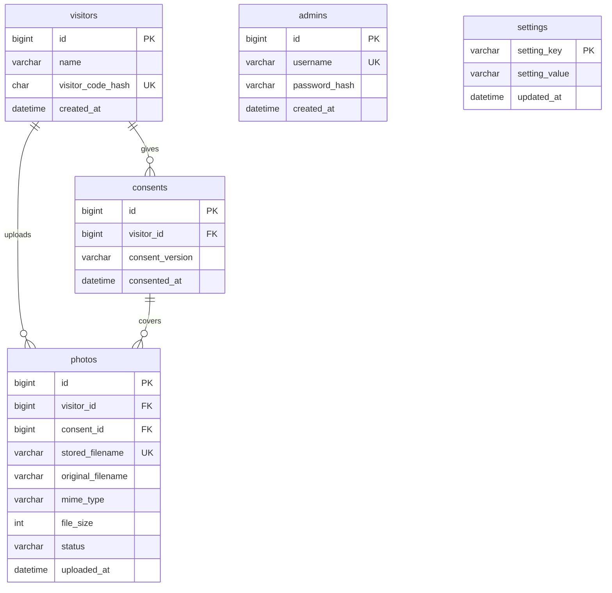

# Architecture

Status: **Steps 1 to 7.** The database schema, configuration, visitor registration and identification, photo uploads, visitor gallery, and automatic public slideshow exist. Administrator pages remain unbuilt.

---

## 1. Project overview

The Visitor Photo Slideshow System lets visitors (for example at an event) upload photographs and
agree to have them shown on a public slideshow screen. Visitors are identified by a unique visitor
code, so a returning visitor can add more photographs and keep the old ones. Administrators manage
visitors and photographs.

Technology: **PHP 8.2+, MySQL 8+ (or MariaDB), Apache, PDO.** No framework, no Composer packages,
no JavaScript. One common codebase runs on Windows (XAMPP) and Ubuntu.

---

## 2. PHP and MySQL architecture (partly built)

Three layers, kept separate so each can change without rewriting the others:

| Layer | Responsibility | Location (planned) |
|-------|----------------|--------------------|
| Presentation | HTML pages and form handling; no SQL, no file-system code | project root pages and `admin/` |
| Application logic | Rules: validation, consent checks, upload flow, code generation | `includes/` (reusable functions) |
| Data and storage | PDO queries (prepared statements only) and file storage | `includes/` (database and storage modules) |

**Built in Step 2** (the foundation every later module uses):

| File | Responsibility |
|------|----------------|
| `config/config.php` | Configuration loader: `app_config()`, `app_path()`, `app_url()` |
| `config/database.php` | `db_connection()`: the shared PDO connection |
| `includes/bootstrap.php` | Common start-up: error handling, time zone, loads the two files above |
| `tests/check_database.php` | Command-line check of the configuration and the database |

Step 1 planned `config.php` and `database.php` inside `includes/`; they were placed in `config/`
instead, as the Step 2 brief requires. The separation between configuration, connection and start-up is
unchanged.

**Built in Step 3** (visitor registration):

| File | Layer | Responsibility |
|------|-------|----------------|
| `register.php` | Presentation | The registration page: reads the form, calls the functions below, writes the HTML. It contains no SQL. |
| `includes/security.php` | Application logic | Secure session start, CSRF token, security headers, `html_escape()`. Used by every page that shows a form. |
| `includes/visitors.php` | Application logic and data | Name validation, code generation, code hashing, and `visitor_register()`, which runs the one prepared `INSERT` and the collision retry. |

The public slideshow is implemented in `slideshow.php` and `slideshow_photo.php`, with selection and validation helpers in `includes/slideshow.php`. Administrator modules remain unbuilt.

**How the connection works.** `db_connection()` opens one PDO connection the first time it is called and
returns the same object afterwards, so a page that never needs the database never connects and no
page connects twice. It uses exceptions, real (non-emulated) prepared statements, associative rows,
no persistent connection, a 5-second connect timeout and `utf8mb4`. Right after connecting it sets
the session time zone to `+00:00` (UTC) and the collation to `utf8mb4_unicode_ci`. Database access
always uses **PDO prepared statements**.

**How failures are handled.** A failed connection logs the technical reason on the server and throws
`DatabaseConnectionException` with a fixed message that has no password, user name or server text.
The original PDO exception is deliberately not chained, because its stack trace could contain the
connection arguments; PHP's `zend.exception_ignore_args` is also switched on. A configuration mistake
throws `AppConfigException`, whose message names the setting but never its value. On web requests an
exception handler in the bootstrap shows visitors only "Something went wrong. Please try again
later."; details appear only when `APP_DEBUG` is true, which is refused when `APP_ENV` is production.

### Cross-platform rules (apply to all code)

* Build file paths from `__DIR__` and `DIRECTORY_SEPARATOR`. No `C:\xampp` or `/var/www/html` in code.
* Keep **URLs** (`APP_URL`) separate from **filesystem paths** (`UPLOAD_STORAGE_PATH`).
* Lower-case file names for all PHP and SQL files, and consistent case in every `require`.
* No shell commands, no OS-specific PHP extensions.

---

## 3. Configuration (built in Step 2)

Each setting is looked up in this order: a **real environment variable**, then the optional **`.env`**
file, then a **default** in `config/config.php`. An empty value counts as "not set". A placeholder-only
`.env.example` is committed to the repository. No third-party configuration library is used: a small
PHP function reads the file. `config_load()` reads and validates every setting once per request. The
`.env` file is normally in the project root; the real environment variable `APP_ENV_FILE` can point to
one kept outside the web folder.

| Variable | Purpose |
|----------|---------|
| `APP_NAME`, `APP_DEBUG` | Application name; whether error details may be shown (never in production) |
| `APP_ENV`, `APP_URL` | Environment name and public web address |
| `DB_HOST`, `DB_PORT`, `DB_NAME`, `DB_USER`, `DB_PASSWORD` | Database connection |
| `VISITOR_CODE_PEPPER` | Secret key for hashing visitor codes |
| `UPLOAD_STORAGE_PATH` | Where photographs are stored (empty = default `storage/uploads`) |
| `UPLOAD_MAX_FILES`, `UPLOAD_MAX_FILE_SIZE_BYTES`, `UPLOAD_ALLOWED_MIME_TYPES` | Upload limits |
| `SLIDESHOW_DEFAULT_DURATION_SECONDS` | Default display time; runtime override lives in `settings` |

In Step 2 the loader reads every variable above **except** `VISITOR_CODE_PEPPER`,
`UPLOAD_ALLOWED_MIME_TYPES` and `SLIDESHOW_DEFAULT_DURATION_SECONDS`, which later steps will add.
Step 3 did not add any of them (see section 5 for why `VISITOR_CODE_PEPPER` is still unused).
Values are checked before use (for example the database host, name and port are restricted to safe
characters because they are placed in the connection string), and the storage path must be an absolute
path for the operating system in use.

Values an administrator should change while the system is running (such as the slideshow duration)
live in the `settings` table. Values that are secrets or machine-specific live in `.env`.

---

## 4. Security zones and where files live

The required project layout places `config/`, `includes/`, `database/`, `storage/` and `tests/`
inside the same folder as the web pages. Two things protect them:

1. **Apache deny rules.** Each private folder has an `.htaccess` file containing `Require all denied`,
   and the README adds the same rules to the Ubuntu virtual host (which does not depend on
   `AllowOverride`). XAMPP honours `.htaccess` by default.
2. **Configurable locations.** `UPLOAD_STORAGE_PATH` (and the location of `.env`) can point to a
   folder **outside** the web-served directory. This is the recommended production setup and the
   strongest protection, because the files are then unreachable by URL whatever the web server does.

Photographs are never served by direct URL. A planned PHP script reads the file from private storage
and sends it only if the photograph is allowed to be shown (see section 9).

---

## 5. Visitor identification approach

* The system **generates a random visitor code** and shows it to the visitor once.
* Only a **hash** is stored, as 64 hex characters in `visitors.visitor_code_hash`, which has a `UNIQUE` index.
  The Step 1 design was a **keyed** hash, `HMAC-SHA-256(code, VISITOR_CODE_PEPPER)`. **What Step 3 actually
  does is a plain `SHA-256(code)`**, because the Step 3 brief asks for SHA-256 and the configuration loader does not
  read `VISITOR_CODE_PEPPER` yet (see "Built in Step 3" below and `ASSUMPTIONS.md`, G1).
* The plaintext code is never stored in the database, logs or files.
* A returning visitor types the code; the application computes the same hash and does one indexed
  lookup. This stays fast with many visitors, which a per-row salted hash (bcrypt) would not.
* Planned (keyed) design: because the hash is keyed with a secret that is not in the database, a database
  leak alone does not allow codes to be recovered by guessing. With the plain SHA-256 used in Step 3 that
  protection comes from the length of the code instead: a code has 160 random bits, so a stolen hash
  cannot realistically be reversed by guessing, but it also has no secret behind it.
* Visitors give only a name: no phone number and no email address.

Limitation: anyone who obtains a code can act as that visitor. Rate limiting of code attempts is a
future step (see section 12).

### Built in Step 3: visitor registration

```
GET  register.php                  -> form (hidden CSRF token from the session)
POST register.php  action=register -> 1 check CSRF token         (fail: 403, nothing stored)
                                      2 validate the name        (fail: 422, form shown again)
                                      3 make a code (random_bytes), hash it (SHA-256)
                                      4 INSERT (name, hash) with a prepared statement;
                                        duplicate hash (error 1062) -> new code, retry, max 5 times
                                      5 keep name + code in $_SESSION, use up the CSRF token
                                      6 303 redirect to register.php?registered=1   (Post-Redirect-Get)
GET  register.php?registered=1     -> shows the code from the session (same code on every refresh)
POST register.php  action=clear    -> forgets the result ("register another visitor")
```

* **Code:** 20 bytes from `random_bytes()` (160 bits), Base32 letters `A-Z2-7`, 8 groups of 4 with hyphens (39 characters).
* **Hash input:** the code in capital letters without hyphens and spaces (`visitor_code_normalize()`), so a code typed later
  in lower case or without hyphens gives the same hash. The returning-visitor step must hash with `visitor_code_hash()` from `includes/visitors.php`.
* **Collision handling:** the unique key `uq_visitors_code_hash` is the check. A failed insert stores nothing, so a retry cannot leave a half-registered visitor.
  Looking the hash up first and inserting afterwards would not be safe when two visitors register at once.
* **Where the plaintext code exists:** on the visitor's screen, and in the server-side PHP session for up to 15 minutes so that the result page can be refreshed.
  It is never in a database column, a log message or an exception message.
* **No duplicate on refresh or double click:** the result page is a `GET`; the `POST` is answered with a redirect; the CSRF token is single-use, and PHP's default
  file session handler lets only one request per session run at a time, so a second simultaneous `POST` meets the used-up token. This relies on the default
  session handler; a custom handler without locking would need its own protection.
* **The session id is not renewed** after registering. Registering gives the visitor no extra rights, and renewing the id deleted the session
  file that a simultaneous second request was waiting for, which let a double click register twice (found in testing; see `AI_LOG.md`). Session-id renewal belongs
  at administrator login, a later step.
* **Transport and headers:** the session cookie is `HttpOnly`, `SameSite=Lax`, `Secure` over HTTPS; pages are sent with `Cache-Control: no-store` and a restrictive
  `Content-Security-Policy` (ordinary visitor pages keep CSS/JavaScript blocked; the public slideshow opts into its own same-origin CSS and image endpoint; JavaScript remains blocked).
* **URLs:** the form action and the redirect are relative (`register.php`), so they work in a sub-folder (XAMPP) and at the site root (Ubuntu) without depending on `APP_URL`.
  `APP_URL` is used only to decide the cookie's `Secure` flag.

---

## 6. Database tables and relationships

Five tables, all InnoDB, `utf8mb4` with `utf8mb4_unicode_ci`, `BIGINT UNSIGNED` identifiers.



`admins` and `settings` are standalone: they have no relationships to the visitor tables.

### Relationship rules

| Relationship | Rule |
|--------------|------|
| visitor → consents | One visitor, many consent records. A **new record is created for every photo upload session**, even when the consent text version has not changed, so several records can share the same visitor and the same `consent_version`. There is no unique key on (visitor, consent version). |
| visitor → photos | One visitor, many photographs. |
| consent → photos | Each photograph references exactly one consent record (`consent_id NOT NULL`): the record created for the upload session in which it was uploaded. One consent record can cover many photographs (all photographs of that session). |
| photo → consent + visitor | The composite key `(consent_id, visitor_id)` must match a row in `consents`, so a photograph can never use another visitor's consent. |
| Deleting | All foreign keys are `ON DELETE RESTRICT`: parents cannot be removed while children exist. |

### Indexes (and why)

| Index | Purpose |
|-------|---------|
| `visitors.uq_visitors_code_hash` | Returning-visitor lookup by code; guarantees unique codes |
| `visitors.idx_visitors_name` | Administrator search by name |
| `consents.idx_consents_visitor_version` | Ordinary (non-unique) index on `(visitor_id, consent_version)`: foreign-key support and lookup of a visitor's consents. It does not prevent several records with the same version. |
| `consents.uq_consents_id_visitor` | Target of the composite foreign key from `photos` |
| `photos.uq_photos_stored_filename` | No two photographs can share a stored file |
| `photos.idx_photos_visitor` | A visitor's gallery (InnoDB adds `id`, so it is `(visitor_id, id)`) |
| `photos.idx_photos_consent_visitor` | Foreign-key support for the composite key |
| `photos.idx_photos_status` | Slideshow and administrator filters (`status`, then `id`) |
| `admins.uq_admins_username` | Unique, case-insensitive administrator names |

Verification: the AI imported `database/schema.sql` into an empty MySQL 8.0 database in its own sandbox and tested
the unique, foreign-key, `NOT NULL`, `CHECK` and delete-restriction rules, and that several consent records
for the same visitor and version are accepted. These are AI-environment tests, not student tests; see
`AI_LOG.md` for exactly what was run and what was not.

---

## 7. Photo storage approach (built in Step 5)

* **No image data in MySQL.** The database holds only metadata (name, size, type, status).
* Files are written to a **private directory**: `UPLOAD_STORAGE_PATH`, or `storage/uploads/` inside the project when that is empty.
  **Recommended: a folder outside the project and outside the web root** (README, "Private photograph storage"). A folder inside the
  project is protected only by web-server rules (`storage/.htaccess` and, on Ubuntu, the virtual host). Those rules are a safety net, not
  something this design relies on, so the upload code writes a warning to the server log and `tests/check_upload.php` prints one
  when the folder is inside the project.
* **Server-generated names.** The stored name is 24 random bytes from `random_bytes()` written as 48 lower-case hex characters, a dot and an
  extension chosen from the **detected** content type (`jpg`, `png` or `webp`), for example `3f9c…e1.jpg` (at most 53 characters; the column is 64).
  The visitor's original file name is cleaned (last path part only, valid UTF-8, no control characters, at most 255 characters) and saved
  only as metadata in `photos.original_filename`; it is never used to build a path.
* **Organized directories.** Files are grouped into sub-folders named after the first two characters of the stored name
  (`<storage>/3f/3f9c…e1.jpg`). The folder is calculated from the name, so the database needs no path column and no single folder grows huge.
  `upload_stored_path()` accepts only names of exactly that shape, so no `..` or path separator can reach the file system.
* **Files are never executed or served directly.** The extension comes from the content type, nothing in the storage folder is reachable
  by a URL when the folder is outside the web root, and the later gallery and slideshow steps will stream files through PHP after checking
  permission and consent.
* **Replaceable storage.** All file operations sit in `includes/uploads.php`. The database stores only `stored_filename`, never an absolute path.
* Uploads are validated by PHP upload error, size, count, **detected** content type (Fileinfo), the file name extension and
  `getimagesize()` (the file must be a real image of that type), not by what the browser claims.

### Built in Step 6: the visitor gallery and the private photo endpoint

| File | Layer | Responsibility |
|------|-------|----------------|
| `gallery.php` | Presentation | Lists the identified visitor's photographs, 20 per page, with Previous/Next links, an upload link and the logout button. No SQL. |
| `photo.php` | Presentation | `GET photo.php?id=N`: checks ownership and visibility, resolves the file safely, sends it with `readfile()`. |
| `includes/gallery.php` | Application logic and data | The visibility rule as SQL (count, one page, one photograph), number and page validation, `gallery_resolve_file()` (safe path), `gallery_detect_mime()`. No HTML, no session code. |

```
gallery.php      session -> visitor id (from the server-side session only)
                 COUNT(*) of visible photos            -> total, number of pages
                 clamp the requested page into range   -> LIMIT 20 OFFSET (page-1)*20, newest first
                 for each row:    (no path, no stored name in the page)

photo.php?id=N   1 GET/HEAD only                              else 405
                 2 identified visitor (session)               else 401
                 3 id is a positive whole number              else 400
                 4 SELECT ... WHERE id = ? AND visitor_id = <session> AND status = 'active'
                   Private OR Public with matching consent     else 404 (same answer as "not yours")
                 5 stored name has the generated shape; realpath() of the file lies INSIDE
                   realpath(UPLOAD_STORAGE_PATH); regular readable file   else 404
                 6 Fileinfo says JPEG/PNG/WebP and equals photos.mime_type   else 404
                 7 headers + readfile()
```

* **Ownership.** The visitor id is never read from the address or a form. The same `WHERE` clause that lists photographs also guards the
  image endpoint, so changing the number in `photo.php?id=N` cannot reach another visitor's photograph: the query finds nothing.
* **Current visibility.** A visitor may see their own active Private photos without a public consent record, and their own active Public photos with a matching consent row. Public visibility alone is not enough for the shared slideshow: administrator approval and unwithdrawn public consent are also required. See Step 11 and `ASSUMPTIONS.md`.
* **Path safety.** Three layers: the stored name must match `^[a-f0-9]{48}\.(jpg|png|webp)$` (so `..`, separators and `.php` cannot pass);
  `realpath()` resolves the file and any symbolic link; the result must start with the real storage folder plus a separator (so a sibling
  folder with a similar name does not pass; case-insensitive on Windows). Paths are never written to a page, a header or the error log.
* **Never executed.** The file is sent only with a fixed `Content-Type` taken from the detected type (`image/jpeg`, `image/png`, `image/webp`),
  `X-Content-Type-Options: nosniff`, `Content-Security-Policy: default-src 'none'; sandbox`, a generated `Content-Disposition` name
  (`photo-<id>.<ext>`) and `Cross-Origin-Resource-Policy: same-origin`. PHP code inside a file named `.png` is detected as "not an image" and refused.
* **Sessions.** `photo.php` closes the session (`session_write_close()`) before sending, so the many image requests of one gallery page do not queue behind each other.
* **Pagination.** `COUNT(*)` for the total, then `LIMIT 20 OFFSET n` for the page only; nothing else is read into PHP memory. `ORDER BY p.id DESC`
  follows `idx_photos_visitor` (InnoDB appends `id`). `OFFSET` is acceptable here because one visitor has few photographs; the slideshow (section 9) uses an id cursor instead.
* **Content-Security-Policy.** Pages still send `default-src 'none'`. Only `gallery.php` adds `img-src 'self'` so the browser may load images from this site.

---

## 8. Upload flow and consistency (built in Step 5)

`upload.php` (page) and `includes/uploads.php` (logic), in this order:

1. **Authentication:** `visitor_require_login()`. The visitor id comes only from the server-side session (Step 4); the form has no visitor field.
2. **Request size:** a request larger than `post_max_size` arrives with an empty `$_POST` and `$_FILES`; it is reported as too large (HTTP 413).
3. **CSRF token.**
4. **Consent:** the consent box must be ticked in this request. Consent is never automatic and is asked for in every upload session.
5. **File checks** (`upload_process()`): number of files (more than `UPLOAD_MAX_FILES` rejects the whole submission), then for each file the PHP
   upload error, `is_uploaded_file()`, size (not empty, not above `UPLOAD_MAX_FILE_SIZE_BYTES`), Fileinfo type, extension for that type, and
   `getimagesize()`. A file that fails is rejected and reported; the others continue.
6. **Store:** every accepted file is moved into private storage under a random name.
7. **Record:** in **one database transaction**: insert a new `consents` row (visitor, consent version, time) for this upload session, then one `photos`
   row per stored file referring to that consent, with the visitor id, stored and original name, detected MIME type, size and status.
8. **Failure:** on any technical failure the transaction is rolled back **and every file stored for this submission is deleted**, because a rollback
   does not remove files. The visitor sees a generic message; details go to the server log.
9. **Post-Redirect-Get:** on success the page redirects to `upload.php?done=1`, which shows the number of photographs saved once.

The accepted files of one submission are stored all together or not at all. A consent row is created only when at least one photograph is stored.
Several visitors uploading at once is safe because names are random and unique (the `stored_filename` key is `UNIQUE`) and each request has its own transaction.

**Status of new photographs:** `photos.status` starts as `active`. The schema defines `active` as "eligible for the slideshow", every stored photograph
has an explicit consent record (the foreign key makes a photograph without one impossible), and the project has no approval step. No page shows photographs yet.

---

## 9. Step 7: public slideshow (implemented)

* `slideshow.php` reads a cursor (`after` photo ID) and selects the next eligible photo using a prepared keyset query (`p.id > cursor`, ascending, `LIMIT 1`). The initial request starts at the oldest eligible photo; subsequent requests never wrap. When no later valid photo remains, the currently displayed final photo is revalidated and the page schedules the presentation-complete state. It fetches one row at a time and never loads the public photo collection into PHP memory.
* Public eligibility requires an existing `visitors` row, `photos.visibility = 'public'`, `photos.status = 'active'`, a matching consent row (`c.id = p.consent_id` and `c.visitor_id = p.visitor_id`), and `c.consent_version = '1.0'`, `c.withdrawn_at IS NULL`, `p.status = 'active'`, and `p.approval_status = 'approved'`. Consent, visitor visibility status, and administrator approval are independent gates. The screen viewer is public and does not need to register; the photo contributor must already be registered/identified to upload.
* `slideshow_photo.php` is a separate public image-serving endpoint. It rechecks public eligibility for every image request, then uses the Step 6 filename/path/MIME validation helpers before streaming from private storage. `photo.php` remains visitor-session/owner-only and is not weakened.
* `SLIDESHOW_DEFAULT_DURATION_SECONDS` is validated by the centralized configuration loader (default 5 seconds); the page offers 5, 8, 10, 15 and 20 second choices and falls back to 5 if another value is configured. The page uses HTML meta refresh and the next ID cursor. Each full reload performs a new database lookup, which is also how new approvals are discovered. The empty state retries after 30 seconds.
* The selected image is validated with PHP `getimagesize()`, then its original bytes are streamed from private storage. `slideshow.css` gives it the remaining viewport stage and applies automatic intrinsic dimensions, `max-width: 100%`, `max-height: 100%` and `object-fit: contain`. This adapts to the real browser viewport and avoids cropping/stretching. It does not force small sources to enlarge, so low-resolution uploads are not artificially upscaled; their own native detail still limits sharpness.
* CSS is used only by the slideshow and is allowed by a narrow `style-src 'self'` CSP permission on that page. JavaScript remains blocked. No external package, CDN, or image processing library is used.
* This is page-refresh progression, not true real-time push or uninterrupted animation. Network/server/image transfer time can extend the actual interval.
* Historical Step 7 note: at that stage no schema migration had been applied. Step 11 later adds `photos.visibility` and nullable `consent_id` through `database/step11_photo_visibility_migration.sql`. Unexpected statuses, including any manually introduced rejected/deleted-like value, do not match `active`; physical/database deletion removes the record.

## 10. How returning visitors are handled (implemented)

1. The visitor enters their code; the application hashes it (with `visitor_code_hash()`, the same function registration uses) and looks up `visitors`. *(Built in Step 4: `identify.php`.)*
2. If found, the visitor's earlier photographs stay in place; new uploads are added alongside them.
3. Every new upload session asks for consent again, even if the visitor consented earlier to the same
   consent version. A new `consents` row is created for that session before any new photograph is accepted.
   Earlier consent records, and the photographs that reference them, are left unchanged.
4. The visitor's gallery is **paginated** using `id`-based paging.

---

## 11. Scalability design (what is built into the design)

* `BIGINT UNSIGNED` identifiers; indexes on lookup columns.
* Pagination for every gallery and administrator table; no page loads all photographs at once.
* Keyset (`id`) paging instead of `OFFSET`.
* Photos stored outside MySQL and outside the public web directory, in organized folders.
* Reusable functions and separated layers.
* Configurable upload limits and slideshow settings.
* Transactions where consistency matters; unique keys to prevent duplicate records.

---

## 12. Current limitations and possible future improvements

This design is intended to **grow**, but it is **not** claimed to support unlimited users or storage.
It has not been load-tested.

| Limitation | Possible future improvement |
|------------|-----------------------------|
| One web server and one MySQL server | Load balancer, database replication, a read replica for the slideshow |
| Photos live on that server's disk | Move to object storage (S3-compatible) through the `storage` module |
| PHP streams every image | Let the web server send files (`X-Sendfile` / `X-Accel-Redirect`), or use a CDN |
| Full-size images only | Generate thumbnails and resized copies |
| No rate limiting | Throttle code and login attempts |
| Sessions in PHP defaults | Shared session storage if several servers are used |
| No backups | Scheduled database dumps and file backups |
| Slideshow reloads the page | Use JavaScript if the brief allows it |
| Very low-resolution uploads cannot look detailed on a large TV | Ask uploaders for original/high-resolution files; no software can restore missing source detail |
| Consent withdrawal not modelled | Add a withdrawal timestamp if required |
| The gallery shows full-size files scaled by the browser (Step 6) | Generate thumbnails (needs an image library) |
| A visitor cannot see photographs with status `hidden`, and the schema cannot say why a photograph is hidden (Step 6) | Add a field or status that separates "removed by an administrator" from "hidden by the visitor" |
| The owner gallery does not compare `consent_version`; public slideshow currently accepts only version `1.0` (Steps 6–7) | Review and explicitly migrate the public-consent policy when consent wording changes |


## Step 8: administrator area

`admin/auth.php` centralizes administrator session enforcement, CSRF validation and consent checks. `admin/login.php` verifies `password_hash()` values using `password_verify()` and regenerates the session ID. `admin/create_admin.php` is CLI-only and permits initial setup only while `admins` is empty. Dashboard, visitor and photo pages use PDO; visitor rows are paginated; private previews use an authenticated streaming endpoint.

Photo visibility now has two independent controls: `consents.consent_version='1.0'` records visitor permission for public display; `photos.approval_status='approved'` records administrator approval; `photos.status='active'` means not hidden. Public selection and public image serving enforce all three conditions. New uploads start `pending`.


## Step 9: privacy and security controls

### Consent lifecycle

`consents.withdrawn_at` is nullable. `NULL` means the recorded consent has not been withdrawn;
a UTC timestamp records withdrawal. The authenticated visitor action in `privacy.php` updates
all unwithdrawn consent records belonging to the session visitor in a transaction. Records are
not deleted. The public selection query, public photo-serving query, and administrator approval
check all require `withdrawn_at IS NULL` in addition to the existing consent-version, active
photo, and approved-photo checks.

### Photo access

- Visitor gallery queries and `photo.php` bind the visitor ID from the server-side session and
  the requested photo ID; changing an ID cannot cross visitor ownership.
- `slideshow_photo.php` is intentionally public, but rechecks current consent, active status,
  administrator approval, file location and actual image MIME before serving.
- `admin/photo.php` is protected by administrator authentication and serves administrator-only
  previews. Uploaded files remain in private storage and are not linked by raw filesystem paths.

### Authentication and request controls

- PHP sessions are cookie-only, strict-mode, HttpOnly and SameSite=Lax; Secure is enabled for
  HTTPS. Visitor and administrator login regenerate the session ID. Logout clears session data,
  rotates the ID and expires the cookie.
- Mutating visitor and administrator forms use CSRF tokens and POST.
- PDO uses exceptions, native prepared statements and credentials loaded through the existing
  environment / `.env` configuration loader.
- Uncaught web exceptions are logged and shown as neutral public messages when debug is disabled.
  Production deployments must set `APP_ENV=production` and `APP_DEBUG=false`.

### Schema change

The Step 9 migration adds only `consents.withdrawn_at DATETIME NULL`. New installations use the
updated schema; existing installations run `database/step9_consent_withdrawal_migration.sql`
once. No other table or relationship is changed.


## Step 10: verified implementation boundary

The current PHP source is syntactically valid under PHP 8.4.24 CLI. Static slideshow
rendering/eligibility checks and Step 9 security checks pass. The database-dependent
application paths have not been verified in this review because `pdo_mysql` and a live
MySQL/MariaDB service were unavailable. The current environment is not a Windows XAMPP
or Ubuntu Apache deployment. See `TESTING_REPORT.md`; these limitations are intentional
and must remain visible until target-environment tests are completed.


## Per-photo visibility correction (2026-11-25)

`photos.visibility` is either `private` or `public`, defaulting to `private`. A private photo has `consent_id = NULL`; only its identified owner may retrieve it through `photo.php`. A public photo must be linked to a consent belonging to the same visitor. The shared slideshow and its image endpoint additionally require `visibility='public'`, active status, administrator approval, the expected consent version and no withdrawal timestamp. The admin review queue contains Public photos only. The owner's gallery may list both visibility types and continues to show the owner's copy after public consent is withdrawn.

Visitor names are not unique identity credentials. Registration checks for an existing name and warns the user, but never authenticates or merges based on a name. The original visitor code remains the only returning-visitor identification method.


## Owner-only slideshow and display settings (November 25, 2026)

`my_slideshow.php` is a protected visitor route. It requires the visitor identity from the existing PHP session, then closes the session lock before rendering so the browser can request image bytes and subsequent slides without serializing requests. `gallery_find_next_owner_slideshow_photo()` selects active photos owned by that visitor, including Private photos and the owner's Public photos that remain in the personal gallery. It validates the private-storage path, actual MIME type and image dimensions before returning an id. The image itself is served by the existing `photo.php` endpoint, which independently verifies that the current session owns the requested photo. The personal route does not use `slideshow_photo.php` and cannot make a private image available to the public.

Successful uploads now render two primary next actions: play the personal slideshow or return to upload more photos. Returning-visitor welcome and gallery pages also link to the personal slideshow, so a visitor can replay photos from earlier visits after identifying with the original visitor code. The personal display includes all eligible active photos in that visitor's owner gallery, not only the latest upload batch.

Both the public and personal slideshow expose a Settings control. Activating it navigates to the current photo in a paused state and opens a compact inline settings panel. The panel offers two still-photo transitions (Classic fade and Instant cut), five intervals (5, 8, 10, 15 and 20 seconds), and clearly states the image-fit and screen-mode behavior. Selecting a setting keeps the slideshow paused and preserves the current photo; Resume restarts it with the selected values. Settings do not automatically request fullscreen. This project keeps JavaScript blocked, so browser fullscreen is entered or exited manually with F11. Image rendering uses centered `object-fit: contain`; no cover/crop option is exposed.

No schema migration is needed for this feature: the implementation uses the existing visitor, photo, consent, storage and settings tables.


## 11. Step 13: return visitor auto-play and slide navigation

A successful code match in `identify.php` immediately redirects into `my_slideshow.php?welcome=1`. The owner selector starts with the oldest valid active photo and advances by increasing photo id/upload order without wrapping. After the final active photo has remained on screen for the configured interval, an end-of-presentation overlay appears with Dashboard, Home and Replay actions. Previous navigation stops at the first photo rather than wrapping to the newest. Both selectors are limited to the authenticated visitor and the existing owner-gallery visibility policy. The image bytes continue to be served by `photo.php`, which independently checks ownership.

The owner view provides Back to Dashboard, Stop Slideshow, Previous, Pause/Play, Next, a slide counter and Settings. The public display provides Previous and Stop/Home while continuing to require public consent, administrator approval, active status and no withdrawal. Soft Fade is the default entrance effect. JavaScript remains blocked, so timed advancement is server navigation rather than an in-page script-driven crossfade. No database migration is required.


### Step 14 — finite, photo-first slideshow presentation

The public and owner photo selectors now treat a presentation as a finite sequence. The initial request starts with the oldest eligible photo. Requests with an `after` cursor select only a greater eligible photo; they never fall back to the first photo. Previous-photo selection similarly does not wrap beyond the first slide. The page checks whether a valid next photo exists while rendering the current slide. If there is no next photo, the browser waits for the selected display interval and then opens a completion overlay on top of the revalidated final photo. The public completion overlay offers Home and Replay; the personal completion overlay offers Dashboard, Home and Replay. A manually selected Next action on the last slide reaches the same completion state.

The presentation UI removes the animated video-style progress timeline and all camera-like zoom, pan, blur and reveal effects. The Settings panel now offers only Classic fade and Instant cut, with 5/8/10/15/20 second timing choices. The fade affects opacity only. No JavaScript, database migration, fullscreen API, or new media endpoint is introduced. Owner image requests continue to use `photo.php`; public image requests continue to use the public consent/approval-checking endpoint.


### Step 15 — remove returning-visitor Play interstitial

After a successful visitor-code match, `identify.php` creates the authenticated session and issues a 303 redirect directly to `my_slideshow.php?welcome=1`. The personal slideshow starts from the oldest active photo and advances automatically. There is no separate welcome page or Play button. If an already authenticated visitor opens `identify.php`, that route redirects them to the same personal slideshow. The owner-only photo endpoint and public consent/approval rules are unchanged. No database migration is needed.
