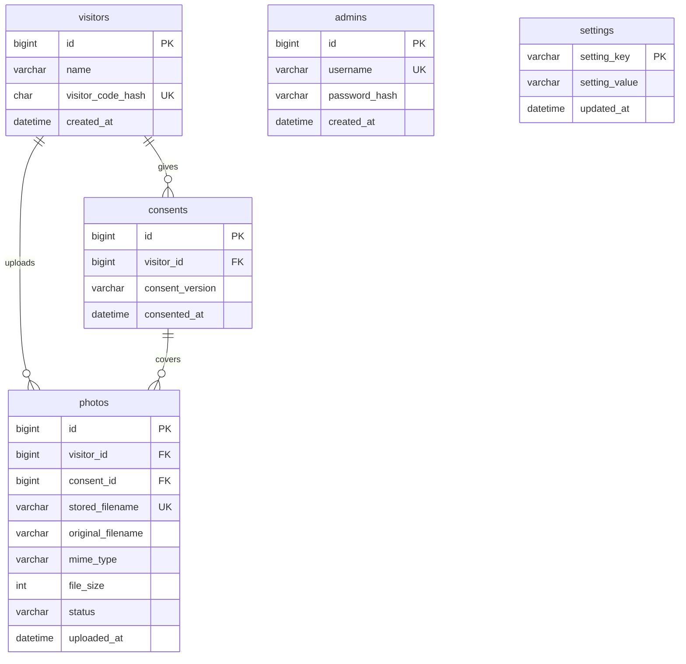

# Architecture

Status: **Step 1 design.** Only the database schema and documentation exist today.
Sections describing PHP code say "planned": nothing described there has been built yet.

---

## 1. Project overview

The Visitor Photo Slideshow System lets visitors (for example at an event) upload photographs and
agree to have them shown on a public slideshow screen. Visitors are identified by a unique visitor
code, so a returning visitor can add more photographs and keep the old ones. Administrators manage
visitors and photographs.

Technology: **PHP 8.2+, MySQL 8+ (or MariaDB), Apache, PDO.** No framework, no Composer packages,
no JavaScript. One common codebase runs on Windows (XAMPP) and Ubuntu.

---

## 2. PHP and MySQL architecture (planned)

Three layers, kept separate so each can change without rewriting the others:

| Layer | Responsibility | Location (planned) |
|-------|----------------|--------------------|
| Presentation | HTML pages and form handling; no SQL, no file-system code | project root pages and `admin/` |
| Application logic | Rules: validation, consent checks, upload flow, code generation | `includes/` (reusable functions) |
| Data and storage | PDO queries (prepared statements only) and file storage | `includes/` (database and storage modules) |

Planned module names (all lower case): `config.php`, `database.php`, `visitors.php`, `consents.php`,
`photos.php`, `storage.php`, `slideshow.php`, `auth.php`. Names may change; the separation will not.

Database access always uses **PDO prepared statements** with the connection charset `utf8mb4` and
the connection time zone `+00:00` (UTC).

### Cross-platform rules (apply to all code)

* Build file paths from `__DIR__` and `DIRECTORY_SEPARATOR`. No `C:\xampp` or `/var/www/html` in code.
* Keep **URLs** (`APP_URL`) separate from **filesystem paths** (`UPLOAD_STORAGE_PATH`).
* Lower-case file names for all PHP and SQL files, and consistent case in every `require`.
* No shell commands, no OS-specific PHP extensions.

---

## 3. Configuration (planned)

Configuration comes from environment-style settings in a `.env` file, with a placeholder-only
`.env.example` committed to the repository. No third-party configuration library is used; a small
PHP function will read the file.

| Variable | Purpose |
|----------|---------|
| `APP_ENV`, `APP_URL` | Environment name and public web address |
| `DB_HOST`, `DB_PORT`, `DB_NAME`, `DB_USER`, `DB_PASSWORD` | Database connection |
| `VISITOR_CODE_PEPPER` | Secret key for hashing visitor codes |
| `UPLOAD_STORAGE_PATH` | Where photographs are stored (empty = default `storage/uploads`) |
| `UPLOAD_MAX_FILES`, `UPLOAD_MAX_FILE_SIZE_BYTES`, `UPLOAD_ALLOWED_MIME_TYPES` | Upload limits |
| `SLIDESHOW_DEFAULT_DURATION_SECONDS` | Default display time; runtime override lives in `settings` |

Values an administrator should change while the system is running (such as the slideshow duration)
live in the `settings` table. Values that are secrets or machine-specific live in `.env`.

---

## 4. Security zones and where files live

The required project layout places `config/`, `includes/`, `database/`, `storage/` and `tests/`
inside the same folder as the web pages. Two things protect them:

1. **Apache deny rules.** Each private folder has an `.htaccess` file containing `Require all denied`,
   and the README adds the same rules to the Ubuntu virtual host (which does not depend on
   `AllowOverride`). XAMPP honours `.htaccess` by default.
2. **Configurable locations.** `UPLOAD_STORAGE_PATH` (and the location of `.env`) can point to a
   folder **outside** the web-served directory. This is the recommended production setup and the
   strongest protection, because the files are then unreachable by URL whatever the web server does.

Photographs are never served by direct URL. A planned PHP script reads the file from private storage
and sends it only if the photograph is allowed to be shown (see section 9).

---

## 5. Visitor identification approach

* The system **generates a random visitor code** and shows it to the visitor once.
* Only a **keyed hash** is stored: `HMAC-SHA-256(code, VISITOR_CODE_PEPPER)` as 64 hex characters in
  `visitors.visitor_code_hash`, which has a `UNIQUE` index.
* The plaintext code is never stored in the database, logs or files.
* A returning visitor types the code; the application computes the same hash and does one indexed
  lookup. This stays fast with many visitors, which a per-row salted hash (bcrypt) would not.
* Because the hash is keyed with a secret that is not in the database, a database leak alone does not
  allow codes to be recovered by guessing.
* Visitors give only a name: no phone number and no email address.

Limitation: anyone who obtains a code can act as that visitor. Rate limiting of code attempts is a
future step (see section 12).

---

## 6. Database tables and relationships

Five tables, all InnoDB, `utf8mb4` with `utf8mb4_unicode_ci`, `BIGINT UNSIGNED` identifiers.

`admins` and `settings` are standalone: they have no relationships to the visitor tables.

### Relationship rules

| Relationship | Rule |
|--------------|------|
| visitor → consents | One visitor, many consent records. A new consent record is created for every photo-upload session, even if the consent version is unchanged. |
| visitor → photos | One visitor, many photographs. |
| consent → photos | Each photograph references exactly one consent record (`consent_id NOT NULL`). |
| photo → consent + visitor | The composite key `(consent_id, visitor_id)` must match a row in `consents`, so a photograph can never use another visitor's consent. |
| Deleting | All foreign keys are `ON DELETE RESTRICT`: parents cannot be removed while children exist. |

### Indexes (and why)

| Index | Purpose |
|-------|---------|
| `visitors.uq_visitors_code_hash` | Returning-visitor lookup by code; guarantees unique codes |
| `visitors.idx_visitors_name` | Administrator search by name |
| `consents.idx_consents_visitor_version` | Lookup of a visitor's consent records by consent version; not unique, so repeat upload sessions can be recorded |
| `consents.uq_consents_id_visitor` | Target of the composite foreign key from `photos` |
| `photos.uq_photos_stored_filename` | No two photographs can share a stored file |
| `photos.idx_photos_visitor` | A visitor's gallery (InnoDB adds `id`, so it is `(visitor_id, id)`) |
| `photos.idx_photos_consent_visitor` | Foreign-key support for the composite key |
| `photos.idx_photos_status` | Slideshow and administrator filters (`status`, then `id`) |
| `admins.uq_admins_username` | Unique, case-insensitive administrator names |

Verification: `database/schema.sql` was imported into an empty MySQL 8.0 database and the unique,
foreign-key, `NOT NULL`, `CHECK` and delete-restriction rules were each tested (see `AI_LOG.md`).

---

## 7. Photo storage approach

* **No image data in MySQL.** The database holds only metadata (name, size, type, status).
* Files are written to a **private directory**: `storage/uploads/` by default or `UPLOAD_STORAGE_PATH`.
* **Server-generated names.** The stored name is random (32 hex characters) plus an extension chosen
  from the detected MIME type. The visitor's original file name is saved only for display and is never
  used to build a path. This blocks path tricks and name collisions between simultaneous uploads.
* **Organized directories.** Files are grouped into sub-folders taken from the first characters of the
  random name (for example `ab/cd/abcd….jpg`). The folder is calculated from the name, so the database
  does not need a path column, and no single folder grows huge.
* **Replaceable storage.** All file operations (save, open, delete) will sit in one `storage` module.
  The database stores only `stored_filename`, never an absolute path, so moving to another storage
  service later means rewriting that one module, not the whole application.
* Uploads are validated by size, count and **detected** content type (not by the file extension the
  visitor supplied).

---

## 8. Upload flow and consistency (planned)

1. Check count, size and type for each file.
2. Make sure the visitor has a consent record for the current consent version.
3. Save files under random names in private storage.
4. Insert all `photos` rows inside **one database transaction**.
5. If anything fails, roll back the transaction and delete the files just written.

Several visitors uploading at once is safe because names are random and unique, and each request
has its own transaction.

---

## 9. How the slideshow will retrieve photographs (planned)

* The slideshow page asks for **one next photograph at a time**, using the last shown `id` as a cursor:
  the first `active` photograph with `id` greater than the cursor, in `id` order. At the end it wraps
  to the start. This needs no `OFFSET`, so it stays cheap as the table grows.
* Only photographs with `status = 'active'` are used. Every photograph has a consent record because
  `consent_id` is mandatory.
* The page displays the image through a PHP "serve photo" script, which re-checks that the photograph
  is allowed, sets the correct content type and streams the file from private storage.
* Display time comes from the `settings` table, falling back to `SLIDESHOW_DEFAULT_DURATION_SECONDS`.
* Because JavaScript is not used, the page advances with an HTML `<meta http-equiv="refresh">`
  carrying the next cursor. This causes a full page reload per photograph. Whether JavaScript may be
  used is an open question (see `ASSUMPTIONS.md`, section E).

---

## 10. How returning visitors are handled (planned)

1. The visitor enters their code; the application hashes it and looks up `visitors`.
2. If found, the visitor's earlier photographs stay in place; new uploads are added alongside them.
3. Before each new photo-upload session, the visitor is shown the public-display consent text and must
   agree. The application creates a new `consents` row for that session, even when the consent text
   version is unchanged. Every photograph in that upload session references that consent row.
4. The visitor's gallery is **paginated** using `id`-based paging.

---

## 11. Scalability design (what is built into the design)

* `BIGINT UNSIGNED` identifiers; indexes on lookup columns.
* Pagination for every gallery and administrator table; no page loads all photographs at once.
* Keyset (`id`) paging instead of `OFFSET`.
* Photos stored outside MySQL and outside the public web directory, in organized folders.
* Reusable functions and separated layers.
* Configurable upload limits and slideshow settings.
* Transactions where consistency matters; unique keys to prevent duplicate records.

---

## 12. Current limitations and possible future improvements

This design is intended to **grow**, but it is **not** claimed to support unlimited users or storage.
It has not been load-tested.

| Limitation | Possible future improvement |
|------------|-----------------------------|
| One web server and one MySQL server | Load balancer, database replication, a read replica for the slideshow |
| Photos live on that server's disk | Move to object storage (S3-compatible) through the `storage` module |
| PHP streams every image | Let the web server send files (`X-Sendfile` / `X-Accel-Redirect`), or use a CDN |
| Full-size images only | Generate thumbnails and resized copies |
| No rate limiting | Throttle code and login attempts |
| Sessions in PHP defaults | Shared session storage if several servers are used |
| No backups | Scheduled database dumps and file backups |
| Slideshow reloads the page | Use JavaScript if the brief allows it |
| Consent withdrawal not modelled | Add a withdrawal timestamp if required |
